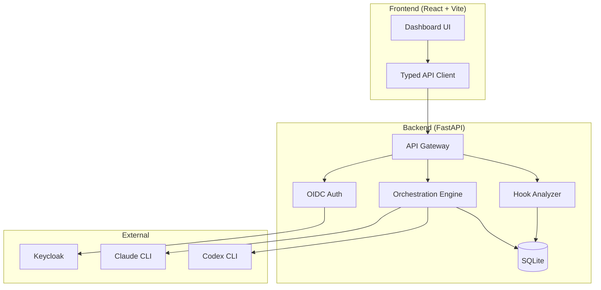

# Signal Lens

> Work in progress. This checkpoint may be incomplete or fail tests. See PLAN.md and STATUS.md before use.


**Ryan Vo | AI & Machine Learning**

Signal Lens is an AI agent workflow orchestration platform that brings rigorous, cross-provider agent workflows to Claude Code, Codex, Copilot, Pi, OpenCode, Muse, Gemini, and Prime Agent. It translates Poteto's pstack primitives for other agent harnesses, enabling reproducible agent workflows with measurable outcomes.

## The Problem

Agent workflows across different providers (Claude Code, Codex, etc.) lack interoperability. Hooks rarely reach subagents, routers are opened in only ~19% of eligible sessions, and cross-provider model reviews (e.g., Claude Opus vs GPT-6) require manual setup. Signal Lens provides a unified orchestration layer with measurable effectiveness tracking.

## AI/ML Approach

Signal Lens implements:

1. **Cross-provider orchestration engine** - Dispatches reviewer tasks to `claude -p` or `codex exec` CLIs with provider-qualified model specifications (e.g., `claude:opus`, `codex:gpt-6.1-sol`)
2. **Hook effectiveness measurement** - Ingests local transcript logs (JSONL) to compute opens-per-100-prompts for main sessions vs subagents, enabling before/after comparison of hook modifications
3. **Deterministic offline core** - All orchestration logic works without LLM keys; LLM explanations are opt-in, labeled advisory, grounded in actual records

## Workflows

1. **Cross-Provider Interrogate** - Run a single workflow that dispatches reviewers to both Claude and Codex CLIs, collects independent reviews, and synthesizes a verdict (incomplete if any reviewer fails)
2. **Hook Effectiveness Analysis** - Ingest transcript logs, compute router/playbook/principle open rates by session type, compare before/after hook changes
3. **Agent Workflow Orchestration** - Define multi-step agent workflows with typed inputs/outputs, persistence, and audit logging

## Quick Start

### Prerequisites

- Docker and Docker Compose
- Node 24+ (for local frontend development)
- Python 3.12+ (for local backend development)

### Using Docker Compose (Recommended)

```bash
# Copy environment template
cp .env.example .env

# Start all services
docker compose up -d

# Access:
# Frontend: http://localhost:5173
# Backend API: http://localhost:8000/api/health
# Keycloak: http://localhost:8080 (admin/admin)
```

### Local Development

**Backend:**
```bash
cd backend
python3 -m venv .venv
source .venv/bin/activate
pip install -r requirements.txt
uvicorn app.main:app --reload --host 127.0.0.1 --port 8000
```

**Frontend:**
```bash
cd frontend
npm install
npm run dev
```

### Testing

**Backend tests:**
```bash
cd backend
source .venv/bin/activate
PYTHONPATH=. pytest tests/ -v
```

**Frontend tests:**
```bash
cd frontend
npm test
```

## Architecture



## API Reference

### Health
- `GET /api/health` - Service health check

### Workflows (Planned)
- `POST /api/workflows` - Create workflow run
- `GET /api/workflows/{id}` - Get workflow status and reviews
- `POST /api/workflows/{id}/reviewers` - Add cross-provider reviewers

### Hook Analysis (Planned)
- `POST /api/hooks/ingest` - Ingest transcript logs
- `GET /api/hooks/effectiveness` - Get effectiveness metrics

## Security

- **Authentication**: OIDC authorization-code flow with PKCE via Keycloak
- **Token storage**: Access tokens kept in memory; PKCE verifier/state in sessionStorage (never localStorage)
- **API**: Bearer-only with role-based authorization (viewer/operator/admin)
- **Demo mode**: Explicitly opt-in, binds to localhost, REFUSES startup in production
- **Secrets**: Only `LLM_API_KEY` is secret; all provider config via environment variables

## Provider Configuration

| Provider | CLI Command | Models | Auth |
|----------|-------------|--------|------|
| Claude | `claude -p` | opus, sonnet, haiku | Anthropic API key or CLI login |
| Codex | `codex exec` | gpt-6.1-sol, gpt-5, etc. | OpenAI API key or CLI login |
| OpenAI-compatible | HTTP | Any | API key |
| Anthropic | HTTP | Any | API key |
| Gemini | HTTP | Any | API key |
| Ollama | HTTP | Local models | None |

## SSO/SAML Setup

Keycloak supports upstream SAML IdPs through identity brokering:

1. Configure Keycloak realm with SAML identity provider
2. Map SAML attributes to Keycloak user attributes
3. Update `OIDC_ISSUER_URL` to point to your realm

## Limitations

- Cross-provider dispatch requires both CLIs installed and authenticated
- Hook analysis requires local transcript logs in JSONL format
- Demo mode is NOT for production use
- SQLite is for development; use PostgreSQL for production

## License

MIT License - Copyright (c) 2024 Ryan Vo <ryandtvo@gmail.com>
